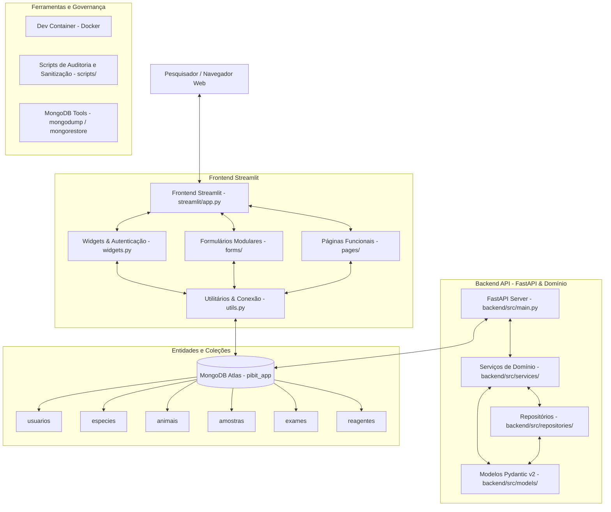

# 🐾 LABVEPI — Sistema de Rastreabilidade Biológica
> **Laboratório de Vigilância de Epizootias — Universidade Federal do Piauí (UFPI)**  
> *Documentação Geral e Arquitetura do Sistema*

---

## 🔬 1. Visão Geral do Projeto

O **LABVEPI** é uma plataforma integrada de gestão científica e rastreabilidade biológica desenvolvida para o Laboratório de Vigilância de Epizootias da Universidade Federal do Piauí (**UFPI**).

O sistema atende a todo o ciclo de vigilância e pesquisa epidemiológica:
- **Catálogo de Espécies e Resolução Taxonômica**: Padronização científica de nomes populares, binômios científicos e classes taxonômicas;
- **Cadastro e Rastreamento de Animais**: Identificação laboratorial (`animal_id`), código HVU (`id_hvu`), microchips, histórico vital e cálculo automatizado de faixa etária;
- **Gestão de Amostras Biológicas**: Controle de coletas, destinos (biobancos e laboratórios parceiros), fases analíticas (`Extração`, `PCR`, `ELETRO`), caixas de armazenamento e material genético disponível (DNA/RNA/sequenciamento);
- **Exames Diagnósticos**: Rastreio de patógenos prioritários (Febre Amarela, Orthoflaviridae, Raiva, Mycoplasma, entre outros) e ensaios laboratoriais (`PCR`, sorologia, etc.);
- **Controle de Reagentes e Estoque**: Gestão de lotes com validação de validade, modelo agregado de estoque com conversão dimensional inteligente e sistema de alertas em tempo real;
- **Importação em Lote e Governança**: Processamento em lote de planilhas CSV/Excel com simulação (*dry-run*) e auditoria de integridade referencial.

---

## 📚 2. Guias e Documentações Específicas

Para facilitar a manutenção e o desenvolvimento da aplicação, a documentação técnica foi estruturada em três partes:

| Documentação | Escopo e Conteúdo | Link de Acesso |
| :--- | :--- | :---: |
| **Geral (Este Documento)** | Visão panorâmica, arquitetura integrada, stack tecnológico, estrutura global e inicialização rápida. | [DOCUMENTACAO_PROJETO.md](file:///home/gio/Documents/UNIVERSIDADE/Pesquisa/PIBIT%202026-2027/pibitapp/DOCUMENTACAO_PROJETO.md) |
| **Backend** | API FastAPI, Modelos de Domínio Pydantic v2, enums, regras de validação taxonômica/dimensional, serviços e repositórios. | [DOCUMENTACAO_BACKEND.md](file:///home/gio/Documents/UNIVERSIDADE/Pesquisa/PIBIT%202026-2027/pibitapp/DOCUMENTACAO_BACKEND.md) |
| **Frontend Streamlit** | Interface multipágina, formulários modulares (`forms/`), dashboards Plotly, RBAC, central de alertas, auditoria e backups. | [DOCUMENTACAO_STREAMLIT.md](file:///home/gio/Documents/UNIVERSIDADE/Pesquisa/PIBIT%202026-2027/pibitapp/DOCUMENTACAO_STREAMLIT.md) |

---

## 🏗 3. Arquitetura Integrada do Sistema

O ecossistema divide-se entre a interface web reativa em **Streamlit**, a camada de serviços e modelos em **FastAPI / Pydantic v2** e o banco de dados em nuvem **MongoDB Atlas**.



---

## 🛠 4. Tecnologias Utilizadas

| Camada | Tecnologia | Finalidade Principal |
| :--- | :--- | :--- |
| **Linguagem** | **Python 3.11+** | Base de desenvolvimento de todo o ecossistema. |
| **Backend API** | **FastAPI & Uvicorn** | API RESTful assíncrona com documentação OpenAPI/Swagger. |
| **Modelos de Domínio** | **Pydantic v2** | Contratos de dados, enums estritos e validação rigorosa de regras laboratoriais. |
| **Frontend Web** | **Streamlit 1.36+** | Interface interativa multipágina (`st.navigation`, `@st.dialog`, `st.pagination`). |
| **Visualização** | **Plotly Express** | Gráficos interativos para dashboards epidemiológicos e de insumos. |
| **Banco de Dados** | **MongoDB Atlas & PyMongo** | Armazenamento NoSQL escalável com TLS/SSL via `certifi`. |
| **Segurança** | **Bcrypt** | Hashing criptográfico unidirecional para senhas de usuários. |
| **Manipulação de Dados** | **Pandas & OpenPyXL** | Leitura e transformação de planilhas CSV e Excel (`.xlsx`). |
| **Infraestrutura** | **Dev Containers & Docker** | Ambiente de desenvolvimento conteinerizado homogêneo. |
| **Backup** | **MongoDB Database Tools** | Utilitários de salvaguarda e recuperação (`mongodump`, `mongorestore`). |

---

## 📂 5. Estrutura Global do Repositório

```
pibitapp/
├── DOCUMENTACAO_PROJETO.md               # Documentação Geral Consolidada (este arquivo)
├── DOCUMENTACAO_BACKEND.md               # Documentação Técnica da API e Modelos Pydantic v2
├── DOCUMENTACAO_STREAMLIT.md             # Documentação Técnica da Interface Web Streamlit
├── planilhas/                            # Planilhas de referência e amostras de dados
├── backend/                              # Camada de Backend
│   ├── requirements.txt                  # Dependências do backend
│   ├── database/                         # Conexões e scripts de banco
│   ├── docs/                             # Notas técnicas e levantamentos analíticos
│   └── src/
│       ├── main.py                       # Servidor FastAPI
│       ├── models/                       # Entidades Pydantic v2 (Animal, Amostra, Exame, Reagente, etc.)
│       ├── services/                     # Serviços de negócio (AnimalService, ReagenteService)
│       └── repositories/                 # Repositórios e catálogos (EspecieRepository)
└── streamlit/                            # Camada de Frontend
    ├── app.py                            # Ponto de entrada do Streamlit
    ├── utils.py                          # Funções utilitárias e conexão com o banco
    ├── widgets.py                        # Componentes de login, sessão e permissões
    ├── forms/                            # Formulários de cadastro modulares
    ├── pages/                            # Páginas da aplicação (Novo Registro, Registros, Relatórios, etc.)
    └── scripts/                          # Utilitários de auditoria, setup de índices e backups
```

---

## 🚀 6. Como Executar o Projeto Localmente

### Pré-requisitos
- Python 3.11 ou superior instalado
- Acesso à internet para conexão com o cluster MongoDB Atlas

### 1. Clonar e preparar o ambiente
```bash
git clone <URL_DO_REPOSITORIO>
cd pibitapp

# Criação e ativação do ambiente virtual
python3 -m venv .venv
source .venv/bin/activate  # Linux/macOS
# ou no Windows: .venv\Scripts\activate
```

### 2. Instalar dependências
```bash
# Dependências da interface web Streamlit
pip install -r streamlit/requirements.txt

# Dependências do backend FastAPI
pip install -r backend/requirements.txt
```

### 3. Executar o Frontend (Streamlit)
```bash
streamlit run streamlit/app.py
```
Acesse a aplicação no navegador em `http://localhost:8501`.

### 4. Executar o Backend (FastAPI) *(Opcional)*
```bash
uvicorn backend.src.main:app --reload --port 8000
```
Acesse a documentação interativa em `http://localhost:8000/docs`.

---

## ⚙️ 7. Configuração de Variáveis e Segurança

A conexão com o MongoDB Atlas é feita de maneira segura por meio de:

1. **Arquivo de Segredos Streamlit (`streamlit/.streamlit/secrets.toml`):**
   ```toml
   [mongo]
   uri = "mongodb+srv://<usuario>:<senha>@cluster.mongodb.net/?retryWrites=true&w=majority"
   ```
2. **Variável de Ambiente do Sistema:**
   ```bash
   export MONGO_URI="mongodb+srv://<usuario>:<senha>@cluster.mongodb.net/?retryWrites=true&w=majority"
   ```

Para detalhes adicionais sobre componentes específicos, consulte:
- 📖 [DOCUMENTACAO_BACKEND.md](file:///home/gio/Documents/UNIVERSIDADE/Pesquisa/PIBIT%202026-2027/pibitapp/DOCUMENTACAO_BACKEND.md)
- 📖 [DOCUMENTACAO_STREAMLIT.md](file:///home/gio/Documents/UNIVERSIDADE/Pesquisa/PIBIT%202026-2027/pibitapp/DOCUMENTACAO_STREAMLIT.md)

---

*LABVEPI — Laboratório de Vigilância de Epizootias | Universidade Federal do Piauí (UFPI)*
