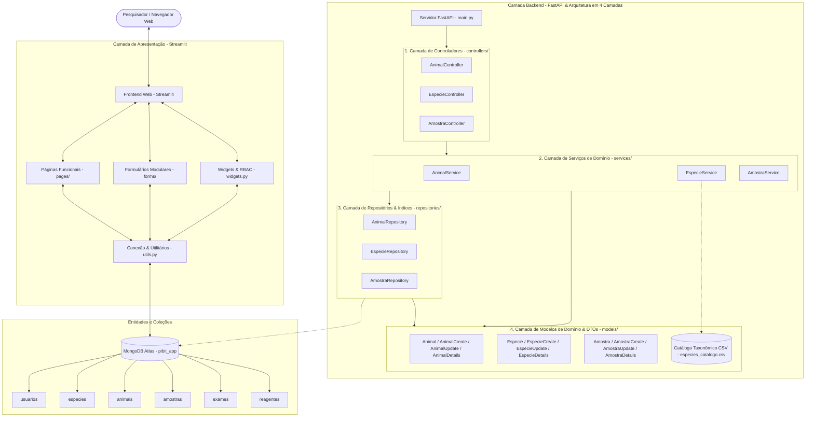

# 🐾 LABVEPI — Sistema de Rastreabilidade Biológica
> **Laboratório de Vigilância de Epizootias — Universidade Federal do Piauí (UFPI)**  
> *Documentação Geral, Arquitetura e Engenharia do Sistema*

---

## 🔬 1. Visão Geral do Projeto

O **LABVEPI** é uma plataforma integrada de gestão científica e rastreabilidade biológica desenvolvida para o Laboratório de Vigilância de Epizootias da Universidade Federal do Piauí (**UFPI**).

O sistema atende a todo o ciclo de vigilância e pesquisa epidemiológica com foco em confiabilidade científica, conformidade taxonômica e rastreabilidade laboratorial:
- **Catálogo de Espécies e Resolução Taxonômica**: Padronização científica de nomes populares, binômios formais (`Gênero sp.` ou binômio completo) e classes taxonômicas com ingestão automática de catálogos de referência (`especies_catalogo.csv`);
- **Cadastro e Rastreamento de Animais**: Identificação laboratorial (`animal_id`), procedência ecológica, órgão de origem, histórico de biometria com conversão de unidades (g para kg), dedução heurística de faixas etárias e correlação com espécies;
- **Gestão de Amostras Biológicas**: Controle estrito de coletas vinculadas aos animais de origem, normalização inteligente de matrizes biológicas (swabs, frações de sangue, tecidos e excretas), destinos (biobancos e laboratórios de referência), fases analíticas (`Extração`, `PCR`, `ELETRO`), caixas de armazenamento e material genético disponível (DNA/RNA/sequenciamento);
- **Exames Diagnósticos**: Rastreio de patógenos prioritários (Febre Amarela, Orthoflaviridae, Raiva, Mycoplasma, entre outros) e ensaios laboratoriais (`PCR`, sorologia, etc.);
- **Controle de Reagentes e Estoque**: Gestão de lotes com validação de validade, modelo agregado de estoque com conversão dimensional inteligente e sistema de alertas em tempo real;
- **Importação em Lote e Governança**: Processamento em lote de planilhas CSV/Excel com simulação (*dry-run*) e auditoria de integridade referencial.

---

## 📚 2. Guias e Documentações Específicas

Para facilitar a manutenção e o desenvolvimento da aplicação, a documentação técnica foi estruturada em três partes:

| Documentação | Escopo e Conteúdo | Link de Acesso |
| :--- | :--- | :---: |
| **Geral do Projeto (Este Documento)** | Visão panorâmica, arquitetura integrada, stack tecnológico, visão geral do backend e da interface Streamlit, guia de inicialização e segurança. | [DOCUMENTACAO_PROJETO.md](file:///home/gio/Documents/UNIVERSIDADE/Pesquisa/PIBIT%202026-2027/pibitapp/DOCUMENTACAO_PROJETO.md) |
| **Backend Consolidado** | Documentação técnica completa e exaustiva: API RESTful FastAPI, Modelos Pydantic v2, DTOs, Services, Repositórios, Testes Automatizados e Regras de Negócio. | [DOCUMENTACAO_BACKEND.md](file:///home/gio/Documents/UNIVERSIDADE/Pesquisa/PIBIT%202026-2027/pibitapp/backend/docs/DOCUMENTACAO_BACKEND.md) |
| **Frontend Streamlit** | Documentação da interface web reativa: Roteamento multipágina (`st.navigation`), formulários modulares (`forms/`), páginas analíticas (`pages/`), dashboards Plotly, RBAC, governança e backups. | [DOCUMENTACAO_STREAMLIT.md](file:///home/gio/Documents/UNIVERSIDADE/Pesquisa/PIBIT%202026-2027/pibitapp/streamlit/DOCUMENTACAO_STREAMLIT.md) |

---

## 🏗 3. Arquitetura Integrada do Sistema

O ecossistema divide-se entre a interface web reativa em **Streamlit**, a arquitetura assíncrona em 4 camadas em **FastAPI / Pydantic v2** e o banco de dados em nuvem **MongoDB Atlas**.



---

## 🛠 4. Tecnologias Utilizadas

| Camada | Tecnologia | Finalidade Principal |
| :--- | :--- | :--- |
| **Linguagem** | **Python 3.11+** | Base de desenvolvimento moderna e tipada de todo o ecossistema. |
| **Backend Web Framework** | **FastAPI & Uvicorn** | Framework RESTful assíncrono de alta performance com OpenAPI/Swagger automático. |
| **Modelagem e Contratos** | **Pydantic v2** | Validação de schemas, serialização estrita, enums e DTOs especializados. |
| **Frontend Web** | **Streamlit 1.36+** | Interface interativa reativa multipágina (`st.navigation`, `@st.dialog`). |
| **Visualização de Dados** | **Plotly Express** | Dashboards epidemiológicos, gráficos temporais e acompanhamento de insumos. |
| **Banco de Dados** | **MongoDB Atlas & PyMongo** | Armazenamento NoSQL escalável, índices textuais e conexões TLS/SSL (`certifi`). |
| **Autenticação & Senhas** | **Bcrypt** | Hashing criptográfico unidirecional seguro para credenciais de acesso. |
| **Engenharia de Dados** | **Pandas & OpenPyXL** | Processamento e ingestão de planilhas laboratoriais CSV e Excel (`.xlsx`). |
| **Testes Automatizados** | **Unittest & TestClient** | Suíte de testes unitários de domínio e testes de integração de API HTTP. |

---

## 📂 5. Estrutura Global do Repositório

```
pibitapp/
├── DOCUMENTACAO_PROJETO.md               # Documentação Geral do Projeto (este arquivo)
├── planilhas/                            # Planilhas de referência e dados laboratoriais históricos
├── backend/                              # Camada de Backend
│   ├── requirements.txt                  # Dependências do backend (fastapi, pydantic, uvicorn)
│   ├── database/                         # Conexões e scripts de banco
│   ├── docs/                             # Especificações e regras do backend
│   │   ├── DOCUMENTACAO_BACKEND.md       # Documentação Técnica Consolidada do Backend
│   │   ├── analise_planilhas_models.TXT  # Correspondência com planilhas reais
│   │   ├── campos_impossiveis.txt        # Especificações de restrições de campos
│   │   └── regras.txt                    # Regras de negócio, permissões e diretrizes
│   ├── tests/                            # Suíte de testes unitários e de integração
│   │   ├── test_animal_service.py        # Testes de animais e biometria
│   │   ├── test_especie_service.py       # Testes de taxonomia e catálogo CSV
│   │   └── test_amostra_service.py       # Testes de amostras e integração HTTP
│   └── src/
│       ├── main.py                       # Servidor ASGI FastAPI
│       ├── controllers/                  # Controladores RESTful (HTTP Routers)
│       ├── data/                         # Dados estáticos (especies_catalogo.csv)
│       ├── models/                       # Modelos Pydantic v2 e DTOs (Diretriz de Entidade Pura)
│       ├── repositories/                 # Repositórios de dados e índices em memória (DAO)
│       └── services/                     # Serviços de negócio, regras e validações
└── streamlit/                            # Camada de Frontend Web
    ├── app.py                            # Ponto de entrada (Roteamento st.navigation, Header & Alertas)
    ├── DOCUMENTACAO_STREAMLIT.md         # Documentação Técnica da Interface Streamlit
    ├── utils.py                          # Conexão MongoDB e utilitários
    ├── widgets.py                        # Componentes de sessão, login e permissões
    ├── forms/                            # Formulários modulares de cadastro (animais, amostras, etc.)
    ├── pages/                            # Páginas operacionais (Novo Registro, Registros, Relatórios, etc.)
    └── scripts/                          # Scripts de governança, auditoria de banco e rotinas de backup
```

---

## ⚙️ 6. Visão Geral do Backend

A camada de backend provê os serviços centrais de processamento, integridade biológica e API RESTful do ecossistema LABVEPI.

### Destaques Arquiteturais do Backend:
- **Padrão em 4 Camadas Desacopladas**: Estruturado em **Controllers** (exposição HTTP e códigos semânticos), **Services** (regras epidemiológicas e laboratoriais), **Repositories** (acesso a dados com indexação em memória $O(1)$) e **Models & DTOs** (Pydantic v2 sob a *Diretriz de Entidade Pura*).
- **Entidades Centrais do Domínio**:
  - `Usuario`: Autenticação e perfis (`Docente`, `Pos-graduando`, `Bolsistas`);
  - `Especie`: Classificação zoológica com resolução automática e catálogo CSV;
  - `Animal`: Rastreamento epidemiológico, biometria com conversão de peso e dedução de faixa etária;
  - `Amostra`: Gestão de matrizes biológicas normalizadas, acondicionamento e biobancos;
  - `Exame`: Ensaios diagnósticos e patógenos prioritários;
  - `Reagente` & `EstoqueReagente`: Gestão de insumos, frascos e consolidação volumétrica de estoque.
- **Regras de Negócio e Integridade**: Resolução cruzada de espécies, bloqueio estrito de exclusão caso existam dependentes (animais com amostras vinculadas ou amostras com exames), tolerância a campos não aferidos (`"Não informado"`) e matriz de permissões (RBAC).
- **Contratos e Testes Automatizados**: Documentação interativa via OpenAPI/Swagger (`/docs`) e suíte de testes com `unittest` e `TestClient`.

> 📖 **Documentação Completa do Backend:**  
> Para detalhes aprofundados sobre modelos, DTOs, métodos dos repositórios, regras de negócio e endpoints HTTP, consulte [DOCUMENTACAO_BACKEND.md](file:///home/gio/Documents/UNIVERSIDADE/Pesquisa/PIBIT%202026-2027/pibitapp/backend/docs/DOCUMENTACAO_BACKEND.md).

---

## 🖥️ 7. Visão Geral do Frontend (Streamlit)

A camada de frontend é uma aplicação web científica construída com **Streamlit 1.36+**, projetada para atender aos pesquisadores e laboratoristas da UFPI.

### Destaques Funcionais do Frontend:
- **Navegação Multipágina e Layout**: Roteamento moderno nativo com `st.navigation` e `st.Page`, cabeçalho institucional oficial (`logo.png`) e identificação de usuário logado.
- **Central de Alertas em Tempo Real (Sidebar)**: Monitoramento proativo contínuo no estoque de insumos, alertando lotes em baixo estoque ($\le 2$ unidades), reagentes próximos da data de expiração (nos próximos 30 dias) e itens vencidos.
- **Formulários Modulares de Cadastro (`forms/`)**:
  - *Animais*: Resolução taxonômica automática, conversão de peso, cálculo de faixa etária e diálogo modal estruturado de revisão (`@st.dialog`);
  - *Amostras*: Vínculo reativo com animais existentes, tipo de matriz biológica, conservação e alíquotas de DNA/RNA;
  - *Exames*: Ensaios (`PCR`, sorologias), patógenos investigados e kits laboratoriais;
  - *Reagentes*: Lotes, fabricantes e validação impeditiva contra validades expiradas.
- **Páginas Operacionais e Analíticas (`pages/`)**:
  - *Novo Registro*: Hub unificado em abas para os formulários de cadastro;
  - *Editar Amostra*: Gestão de status de alíquotas (`Disponível`, `Em uso`, `Esgotada`, etc.), restrita a docentes;
  - *Importação em Lote*: Processamento em cascata de planilhas CSV e Excel (`.xlsx`, `.xls`) com modo simulação (*dry-run*) e estratégias de conflito (*skip*, *upsert*, *replace*);
  - *Registros*: Catálogo completo com busca textual livre, paginação reativa (`st.pagination`) e filtros avançados;
  - *Relatórios*: Painel de KPIs e gráficos estatísticos e epidemiológicos com **Plotly Express**.
- **Autenticação e RBAC**: Criptografia de senhas com salt via **Bcrypt**, sessões protegidas e matriz de permissões com base no perfil acadêmico do usuário.
- **Governança e Banco de Dados**: Scripts de auditoria de integridade referencial (`auditar_banco.py`), configuração de índices (`setup_banco.py`) e rotinas de backup com **MongoDB Database Tools** (`mongodump`/`mongorestore`).

> 📖 **Documentação Completa do Frontend:**  
> Para detalhes completos sobre o fluxo de telas, formulários, RBAC, importações e rotinas de governança, consulte [DOCUMENTACAO_STREAMLIT.md](file:///home/gio/Documents/UNIVERSIDADE/Pesquisa/PIBIT%202026-2027/pibitapp/streamlit/DOCUMENTACAO_STREAMLIT.md).

---

## 🚀 8. Como Executar o Projeto Localmente

### Pré-requisitos
- Python 3.11 ou superior instalado
- Acesso à internet para sincronização com o cluster MongoDB Atlas

### 1. Clonar e preparar o ambiente
```bash
git clone <URL_DO_REPOSITORIO>
cd pibitapp

# Criação e ativação do ambiente virtual
python3 -m venv .venv
source .venv/bin/activate  # Linux/macOS
# ou no Windows: .venv\Scripts\activate
```

### 2. Instalar dependências
```bash
# Dependências do backend FastAPI
pip install -r backend/requirements.txt

# Dependências da interface web Streamlit
pip install -r streamlit/requirements.txt
```

### 3. Executar o Backend (FastAPI)
```bash
uvicorn backend.src.main:app --reload --port 8000
```
- **API Health Check**: `http://localhost:8000/`
- **Documentação Interativa Swagger**: `http://localhost:8000/docs`
- **Documentação ReDoc**: `http://localhost:8000/redoc`

### 4. Executar o Frontend (Streamlit)
```bash
streamlit run streamlit/app.py
```
Acesse a aplicação no navegador em `http://localhost:8501`.

---

## ⚙️ 9. Configuração de Variáveis e Segurança

A conexão com o MongoDB Atlas é feita de maneira segura por meio de:

1. **Arquivo de Segredos Streamlit (`streamlit/.streamlit/secrets.toml`):**
   ```toml
   [mongo]
   uri = "mongodb+srv://<usuario>:<senha>@cluster.mongodb.net/?retryWrites=true&w=majority"
   ```
2. **Variável de Ambiente do Sistema:**
   ```bash
   export MONGO_URI="mongodb+srv://<usuario>:<senha>@cluster.mongodb.net/?retryWrites=true&w=majority"
   ```

---

*LABVEPI — Laboratório de Vigilância de Epizootias | Universidade Federal do Piauí (UFPI)*
